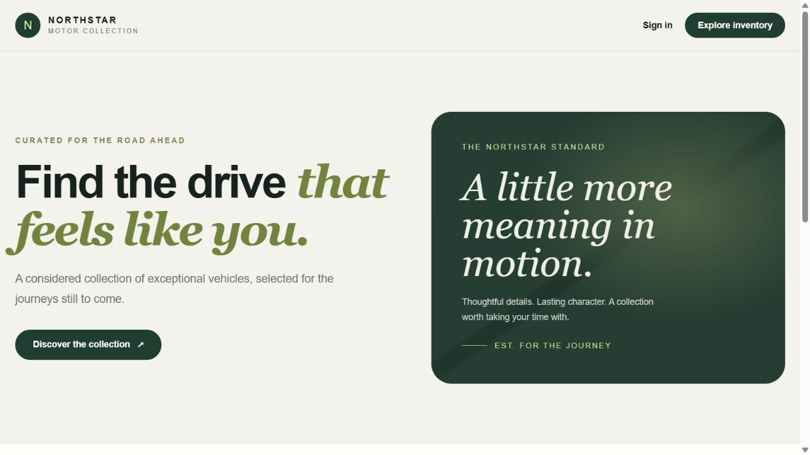
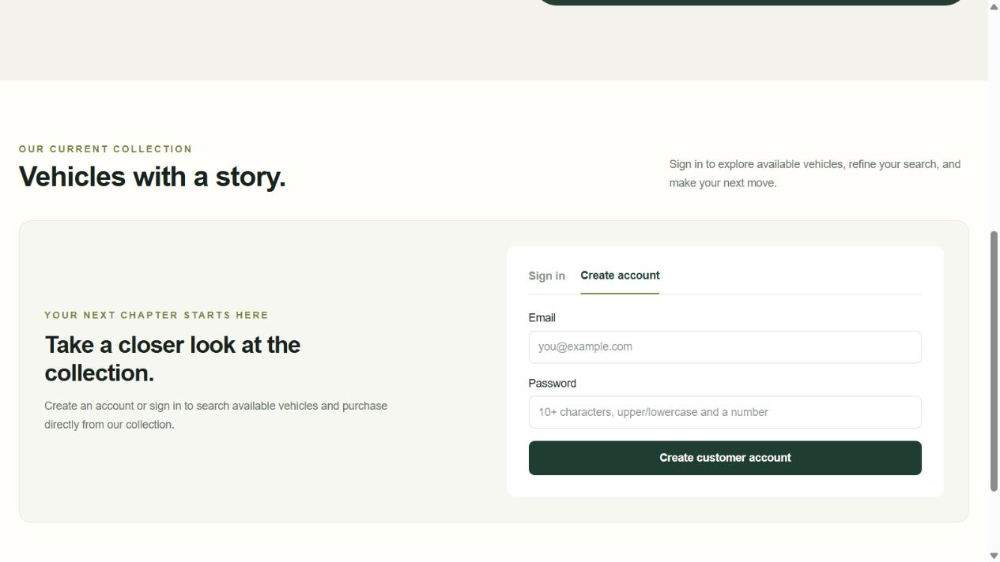

# Car Dealership Inventory System — TDD Kata

A full-stack Car Dealership Inventory System built with Test-Driven Development (TDD), clean SOLID architecture, and persistent PostgreSQL storage. The backend is a TypeScript/Express RESTful API using Prisma ORM and PostgreSQL, and the frontend is a responsive React/Next.js and Tailwind CSS Single-Page Application (SPA) with role-based authentication, live search/filtering, atomic vehicle purchases, and administrator inventory controls.

- **Public GitHub Repository:** [https://github.com/Outrajas/TDD-kata](https://github.com/Outrajas/TDD-kata)
- **Raw AI Prompt Logs:** [`PROMPTS.md`](PROMPTS.md)
- **Automated Test Report:** [`docs/test-report.md`](docs/test-report.md)
- **API & SOLID Reference:** [`docs/api-reference.md`](docs/api-reference.md)
- **Database Schema & ERD:** [`docs/database-design.md`](docs/database-design.md)

## Technology Stack
- **Backend API:** Node.js 20+, TypeScript 6, Express 5, Zod 4
- **Database & ORM:** PostgreSQL 16+, Prisma 7 (`@prisma/adapter-pg`, `pg`)
- **Authentication:** `bcryptjs` password hashing, `jose` HS256 JWT in `HttpOnly` cookie, Role-Based Access Control (`CUSTOMER`, `ADMIN`)
- **Frontend SPA:** React 19, Next.js 16, Tailwind CSS 4, HTML5, CSS3
- **Testing & Quality:** Vitest 5 (Unit & Live HTTP/DB Integration), TypeScript strict mode, ESLint

## Local Setup & Installation
1. **Install dependencies:** `pnpm install`
2. **Configure Environment:** Copy `apps/api/.env.example` to `apps/api/.env` and set `DATABASE_URL` and `JWT_SECRET` (must be at least 32 characters).
3. **Apply Migrations:** `pnpm db:migrate`
4. **Seed Administrator:** `pnpm db:seed:admin` (Requires `ADMIN_EMAIL` and `ADMIN_PASSWORD` env vars).
5. **Start Application:** `pnpm dev`
   - Frontend: `http://localhost:3000`
   - Backend API: `http://localhost:3001`

## Application Screenshots

*Homepage showing the inventory dashboard.*

*Customer account registration with password rules.*

## Architecture & Security
- **SOLID Design:** Routes handle HTTP parsing, Services enforce domain rules, Repositories manage Prisma queries.
- **Concurrency-Safe Purchases:** `InventoryRepository.purchase` uses a Serializable transaction with atomic conditional updates (`WHERE id = ? AND stock_quantity > 0`) to prevent race conditions.
- **Database Integrity:** PostgreSQL CHECK constraints enforce positive prices and non-negative stock, with a PL/pgSQL trigger guaranteeing append-only inventory movements.

## Test Results
Executed via `pnpm test`:
- **API:** 8 test files passed, 22 tests passed (Integration + Unit).
- **Web:** 2 test files passed, 4 tests passed (Component tests).
- **Quality:** `pnpm typecheck` and `pnpm lint` pass with zero errors.

## My AI Usage
- **OpenAI Codex:** Used for scaffolding the monorepo, generating Red-Green-Refactor tests, implementing Express/Prisma repositories, and building the React 19 UI.
- **Google Gemini:** Used for end-to-end repository auditing, fixing Git safe-directory ownership, resolving auth integration test assertions, configuring Vercel serverless deployments, and polishing documentation.
## Live Admin Access
To test the administrator features (Add/Update/Delete/Restock), use the following credentials:
- **Admin Login URL:** https://tdd-kata.vercel.app/admin/login
- **Email:** dmin@dealership.com
- **Password:** AdminPassword123

*Note: This account is pre-seeded on the live production database via the db:seed:admin script.*