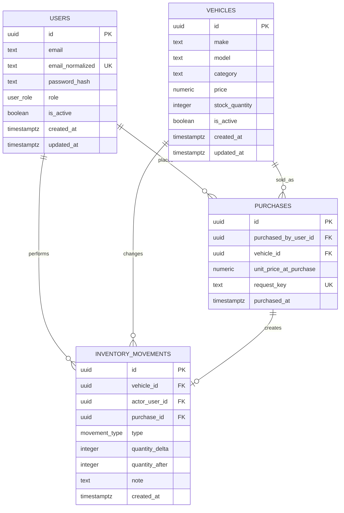

# Database design (implemented)

This is the approved relational design implemented by the Prisma schema and PostgreSQL migrations under `apps/api/prisma`. The API and integration tests use this persistent schema.

## Design goals

- Give each table one clear responsibility: identity, current catalog/stock, completed purchases, and stock-change audit history.
- Keep referential integrity and business invariants in PostgreSQL as well as validating requests in the API.
- Preserve the price charged at purchase time even if the vehicle's current price later changes.
- Make stock updates atomic and record the resulting stock change in the same transaction.
- Keep the kata small: no cart/order workflow, payment provider, refresh-token system, or dealership tenancy.

## Entity relationship diagram

## Tables and columns

### `users`

| Column | PostgreSQL type | Rules | Purpose |
|---|---|---|---|
| `id` | `uuid` | Primary key, generated by the application or `gen_random_uuid()` | Stable user identity. |
| `email` | `text` | Required | Email as supplied/displayed. |
| `email_normalized` | `text` | Required, unique, store lowercase trimmed value | Case-insensitive account lookup and duplicate prevention without relying on application-only checks. |
| `password_hash` | `text` | Required | bcrypt hash only; never store a password or JWT here. |
| `role` | `user_role` enum | Required, default `CUSTOMER` | `CUSTOMER` or `ADMIN`; public registration cannot choose this value. |
| `is_active` | `boolean` | Required, default `true` | Allows an account to be disabled without losing purchase history. |
| `created_at`, `updated_at` | `timestamptz` | Required | Audit and account maintenance. |

**Indexes:** unique index on `email_normalized`; optional index on `(role, is_active)` for admin user management if that feature is added.

### `vehicles`

| Column | PostgreSQL type | Rules | Purpose |
|---|---|---|---|
| `id` | `uuid` | Primary key | Stable vehicle identity used by route `:id`. |
| `make` | `text` | Required, trimmed and non-empty | Manufacturer, e.g. `Toyota`. |
| `model` | `text` | Required, trimmed and non-empty | Model name, e.g. `Corolla`. |
| `category` | `text` | Required, trimmed and non-empty | Searchable category such as `SUV` or `Sedan`. |
| `price` | `numeric(12,2)` | Required, `CHECK (price > 0)` | Current asking price. Use decimal/money-safe values, not floating point. The app should document one display currency for this kata. |
| `stock_quantity` | `integer` | Required, default `0`, `CHECK (stock_quantity >= 0)` | Current stock snapshot used for fast listing and atomic updates. |
| `is_active` | `boolean` | Required, default `true` | Soft-delete flag. Inactive vehicles do not appear in browse/search and cannot be purchased. |
| `created_at`, `updated_at` | `timestamptz` | Required | Record lifecycle timestamps. |

**Indexes:** composite indexes on `(make, model)` and `(is_active, stock_quantity)`, plus B-tree indexes on `category` and `price`. The API filters inactive and out-of-stock rows. If substring search becomes slow on a large inventory, add `pg_trgm` GIN indexes after measuring query plans.

The brief provides make, model, category, price, and quantity. Keeping make/model/category as text avoids lookup-table administration endpoints that the kata does not request. Normalize whitespace and case for comparisons in the API; add lookup tables only if the product later needs controlled brand/category lists.

### `purchases`

One row records one successful call to purchase one vehicle. The current API purchases one unit per request, so a separate order header and line-item model would add no value yet.

| Column | PostgreSQL type | Rules | Purpose |
|---|---|---|---|
| `id` | `uuid` | Primary key | Purchase receipt identity. |
| `purchased_by_user_id` | `uuid` | Required FK → `users.id`, `ON DELETE RESTRICT` | Authenticated customer/admin who made the purchase. |
| `vehicle_id` | `uuid` | Required FK → `vehicles.id`, `ON DELETE RESTRICT` | Vehicle sold. Restrict hard deletion so the history remains meaningful. |
| `unit_price_at_purchase` | `numeric(12,2)` | Required, `CHECK (> 0)` | Price snapshot at the moment of purchase. |
| `request_key` | `text` | Nullable; unique with `purchased_by_user_id` when present | Optional idempotency key to prevent a retried network request from charging/decrementing twice. |
| `purchased_at` | `timestamptz` | Required, default `now()` | Purchase timestamp. |

**Indexes:** `(purchased_by_user_id, purchased_at DESC)` for a user's history; `(vehicle_id, purchased_at DESC)` for vehicle sales history; unique `(purchased_by_user_id, request_key)` for retry safety. Null request keys remain allowed for callers that do not supply the optional header.

### `inventory_movements`

Append-only audit ledger for every change to `vehicles.stock_quantity`. A purchase produces a negative movement; a restock produces a positive movement. The vehicle row remains the fast current-stock value, and this ledger explains how it changed.

| Column | PostgreSQL type | Rules | Purpose |
|---|---|---|---|
| `id` | `uuid` | Primary key | Movement identity. |
| `vehicle_id` | `uuid` | Required FK → `vehicles.id`, `ON DELETE RESTRICT` | Vehicle whose stock changed. |
| `actor_user_id` | `uuid` | Required FK → `users.id`, `ON DELETE RESTRICT` | User who caused the change. |
| `purchase_id` | `uuid` | Nullable FK → `purchases.id`, unique when present | Links a sale movement to its purchase; restocks leave it null. |
| `type` | `inventory_movement_type` enum | Required: `PURCHASE`, `RESTOCK`, `INITIAL_STOCK`, or `ADJUSTMENT` | Reason for the stock change. |
| `quantity_delta` | `integer` | Required, non-zero | Signed movement: purchase is negative, restock is positive. |
| `quantity_after` | `integer` | Required, `CHECK (quantity_after >= 0)` | Resulting stock after this movement, useful for audit/debugging. |
| `note` | `text` | Optional | Admin explanation for a manual adjustment. |
| `created_at` | `timestamptz` | Required, default `now()` | Movement timestamp. |

**Indexes:** `(vehicle_id, created_at)` for inventory history and `(actor_user_id, created_at)` for user activity. Database checks enforce nonzero movements, nonnegative resulting stock, and the matching sign for each movement type. A PostgreSQL trigger rejects updates and deletes so this ledger stays append-only.

## Relationship and deletion rules

- A user can place many purchases and perform many inventory movements.
- A vehicle can appear in many purchase records and inventory movements.
- One purchase has at most one linked stock movement; restocks and initial/manual adjustments have no purchase row.
- Creating a vehicle with opening stock and changing its quantity through the admin update endpoint append `INITIAL_STOCK` or `ADJUSTMENT` movements in the same transaction.
- Deleting a vehicle in the API should set `is_active = false` (soft delete). Historical purchases and movements keep their foreign keys and remain reportable.
- Deactivating a user preserves the user row referenced by purchase and movement history.
- Hard deletion is reserved for cleanup of records that have no history and is not exposed by the kata API.

## Transaction boundaries for the endpoints

### Purchase: `POST /api/vehicles/:id/purchase`

Run one database transaction:

1. Conditionally decrement `stock_quantity` only where `id = ?`, `is_active = true`, and `stock_quantity > 0`; return the new quantity and current price.
2. If no vehicle row was updated, return `404` for missing/inactive vehicle or `409` for out of stock (distinguish with a read in the same transaction if needed).
3. Insert `purchases` with the authenticated user and a snapshot of the current price.
4. Insert `inventory_movements` with `type = PURCHASE`, `quantity_delta = -1`, the new `quantity_after`, and the purchase ID.
5. Commit. If any insert fails, rollback the stock decrement too.

Prefer a single conditional SQL update (`UPDATE ... SET stock_quantity = stock_quantity - 1 WHERE ... RETURNING ...`) or an equivalent Prisma atomic update guarded by a positive-stock check. Never do an unguarded read-then-decrement. Concurrent requests for the last unit must allow exactly one success.

### Restock: `POST /api/vehicles/:id/restock`

In one transaction, atomically increment stock by the validated positive integer and insert the matching `RESTOCK` movement with the actor and resulting `quantity_after`. Use a database check so stock cannot become negative, and reject integer overflow before updating. Vehicle creation with an initial positive quantity writes an `INITIAL_STOCK` movement; admin quantity changes append a signed `ADJUSTMENT` movement.

## Authentication storage choice

The API stores a short-lived JWT in an `HttpOnly`, `SameSite=Lax` cookie. The kata does not need a token table or refresh-token workflow. The cookie expires after 15 minutes; immediate server-side revocation is outside this iteration.

## Prisma mapping and migrations

Prisma models `User`, `Vehicle`, `Purchase`, and `InventoryMovement` map camelCase fields to snake_case tables and columns. UUID primary keys are used throughout; prices use `Decimal @db.Decimal(12, 2)` and timestamps use `Timestamptz(6)`. The SQL migrations add the price/stock checks, movement direction checks, and append-only ledger trigger that cannot be expressed in the Prisma model language.

The initial migration creates the four tables, foreign keys, unique constraints, and query indexes. The follow-up integrity migration adds the checks and trigger. Local migrations are run using `pnpm db:migrate`.
