# Car Dealership Inventory System — Technical Fishbone

**Effect at the head:** a secure, correct, testable dealership inventory SPA backed by a REST API and persistent PostgreSQL data.

The backend follows the assignment's Express/TypeScript option, with PostgreSQL and Prisma. The workspace keeps the EduPortal-style modular approach, not EduPortal's academic tables or data.

```mermaid
flowchart LR
  spine["System quality: correctness · security · usability · demonstrable TDD"] --- outcome([Reliable dealership inventory system])
  spine --- backend["BACKEND · TypeScript · Node.js 22 · Express 5"]
  spine --- api["REST API · Express · Zod · JSON · /api"]
  spine --- frontend["FRONTEND · Next.js 16 · React 19 · TypeScript · Tailwind 4"]

  backend --> runtime["Express listener · localhost:3001 · dotenv · validated env"]
  backend --> persistence["PostgreSQL · Prisma 7.10 · @prisma/adapter-pg · pg"]
  backend --> schema["PostgreSQL tables: User · Vehicle · Purchase · InventoryMovement · UUID/FK/check constraints"]
  backend --> security["bcryptjs password hashes · jose JWT · CUSTOMER/ADMIN · API middleware"]
  backend --> domain["Zod validation · service layer · atomic stock decrement · database constraints"]
  backend --> backendtests["Vitest · Express HTTP integration tests · PostgreSQL"]

  api --> register["POST /api/auth/register · Zod body · normalize unique email · bcrypt hash · CUSTOMER role only · 201/409/422"]
  api --> login["POST /api/auth/login · verify bcrypt · jose JWT · HttpOnly cookie · 200/401"]
  api --> logout["POST /api/auth/logout · clear HttpOnly cookie · 204"]
  api --> list["GET /api/vehicles · authenticated · customers see available; admins also see zero-stock · pagination · 200"]
  api --> search["GET /api/vehicles/search · make/model/category · minPrice/maxPrice · admins can find zero-stock to restock · 200/422"]
  api --> create["POST /api/vehicles · ADMIN · required fields · price > 0 · quantity >= 0 · 201/401/403/422"]
  api --> update["PUT /api/vehicles/:id · ADMIN · validated replacement fields · 200/404/422"]
  api --> delete["DELETE /api/vehicles/:id · ADMIN · 204/401/403/404"]
  api --> purchase["POST /api/vehicles/:id/purchase · authenticated · atomic quantity - 1 · 200/404/409"]
  api --> restock["POST /api/vehicles/:id/restock · ADMIN · positive quantity · atomic increment · 200/401/403/404/422"]

  frontend --> app["Next.js App Router · server-rendered shell · client-side interactive inventory"]
  frontend --> authui["RegisterForm · LoginForm · React Hook Form + Zod · cookie session · logout"]
  frontend --> fetcher["Typed API client · fetch('/api/...') · credentials include · typed errors"]
  frontend --> browseui["InventoryPage · VehicleGrid · VehicleCard · pagination · loading/empty/error states"]
  frontend --> filterui["SearchBar · Make/Model/Category filters · PriceRange · query-string state"]
  frontend --> purchaseui["PurchaseButton · disabled at quantity 0 · pending/success/error feedback · refresh stock"]
  frontend --> adminui["AdminRouteGuard · VehicleForm · Edit/Delete controls · RestockForm · role-aware navigation"]
  frontend --> styles["Tailwind CSS 4 · responsive layout · accessible labels/focus · status and confirmation UI"]

  spine --> quality["Quality gates · Vitest · ESLint · TypeScript · Red–Green–Refactor commits"]
  spine --> delivery["Git · README · screenshots · test report · My AI Usage · raw PROMPTS.md"]
```

## Backend nodes

| Node | Stack | Technical design |
|---|---|---|
| Runtime and HTTP server | Node.js 22, TypeScript 6.0.3, Express 5 | Standalone API on port 3001; route modules grouped by auth, vehicles, and inventory; JSON responses; centralized error mapping; `dotenv` and Zod validate `apps/api/.env`. |
| Database | PostgreSQL 17+, Prisma ORM 7.10.1, `@prisma/adapter-pg`, `pg` | Persistent local PostgreSQL database named `dealership`; Prisma migrations version schema changes; do not use an in-memory database. `DATABASE_URL` is required. |
| User model | Prisma `User` | UUID id, normalized unique `email`, `passwordHash`, `role` enum (`CUSTOMER`, `ADMIN`), `isActive`, timestamps. Public registration always assigns `CUSTOMER`; `db:seed:admin` provisions the first admin without a public role-escalation route. |
| Vehicle model | Prisma `Vehicle` | UUID id, `make`, `model`, `category`, `price` (`Decimal(12,2)`), `quantity` mapped to `stock_quantity`, `isActive`, timestamps. Index make/model, category, price, and active/stock. Database checks reject nonpositive prices and negative stock. |
| Purchase history | Prisma `Purchase` | One row per successful one-vehicle purchase; FK to buyer and vehicle; `unitPriceAtPurchase` preserves the price snapshot; optional idempotency key. Delete restrictions keep history valid; API delete soft-deactivates the vehicle. |
| Stock audit | Prisma `InventoryMovement` | Append-only opening-stock, purchase, restock, and adjustment entries; FK to vehicle, actor, optional purchase; signed `quantityDelta` and resulting `quantityAfter`. Database checks enforce movement direction and trigger rejects update/delete. |
| Authentication and authorization | `bcryptjs`, `jose`, Express middleware | Hash passwords with bcrypt; issue HS256 JWTs with subject, role, issued-at, and 15-minute expiry. Store JWT in an `HttpOnly`, `SameSite=Lax` cookie; use `Secure` in production. Verify on protected routes and check admin roles server-side. Credentialed CORS is limited to the configured frontend origin. |
| Validation and domain services | Zod 4, typed service modules | Parse every body, path ID, and query parameter at the boundary. Keep stock and authorization rules in services so API handlers remain thin. Return structured errors without leaking password hashes or token secrets. |
| Test foundation | Vitest 5, Express test listener, local PostgreSQL | Unit-test service decisions; integration-test authentication, role enforcement, persistence, search, idempotency, and stock races. Never point tests at production data. |

## API endpoint nodes

All routes use the prefix `/api`. JSON request bodies and responses are implemented unless noted. `401` means missing/invalid authentication; `403` means authenticated but disallowed; `404` means no matching record; `409` means a valid request cannot be completed due to current state; `422` means field validation failed.

| Endpoint | Access | Request and behavior | Important cases covered by tests |
|---|---|---|---|
| `POST /api/auth/register` | Public | `{ email, password }`; normalize email, enforce password policy, hash password, create a `CUSTOMER`, return safe user fields. | Duplicate email → `409`; invalid input → `422`; response never includes `passwordHash`. |
| `POST /api/auth/login` | Public | `{ email, password }`; verify hash and issue expiring JWT cookie. | Invalid credentials → generic `401`; no account enumeration; cookie uses HttpOnly and SameSite settings. |
| `POST /api/auth/logout` | Public | Clear the current browser's JWT cookie. | `204`; JWT remains short lived if another client retained it. |
| `GET /api/vehicles` | Authenticated | Return vehicles with `quantity > 0`; proposed `page` and `pageSize` parameters; stable sort by make/model. | Empty inventory, pagination bounds, stable response shape. |
| `GET /api/vehicles/search` | Authenticated | Optional `make`, `model`, `category`, `minPrice`, `maxPrice`, `page`, `pageSize`; combine supplied filters with AND; case-insensitive text matching; price limits are inclusive. | Reject malformed/negative prices and `minPrice > maxPrice` with `422`; no filters behaves like listing. |
| `POST /api/vehicles` | Admin | `{ make, model, category, price, quantity }`; create inventory record. | Missing/blank fields, price `<= 0`, non-integer or negative quantity; customer cannot create. |
| `PUT /api/vehicles/:id` | Admin | Replace editable vehicle fields after validating the full payload. | Invalid ID/body; nonexistent record; cannot set negative stock or non-positive price. |
| `DELETE /api/vehicles/:id` | Admin | Delete the specified vehicle; successful response `204 No Content`. | Customer receives `403`; nonexistent ID returns `404`. |
| `POST /api/vehicles/:id/purchase` | Authenticated | No client-supplied stock amount; decrement exactly one unit and return a purchase receipt. Optional `Idempotency-Key` prevents duplicate purchases on client retry. | Serializable transaction with conditional atomic stock update and matching purchase/ledger rows. Concurrent last-unit requests allow one success and one `409`; missing/inactive vehicle → `404`. |
| `POST /api/vehicles/:id/restock` | Admin | `{ quantity }` where quantity is a positive integer; add to current stock atomically. | Reject zero, negative, fractional, or overflowing amounts; customer receives `403`; missing vehicle → `404`. |

For purchasing, avoid a read-then-write sequence. Use a single conditional update or transaction that only decrements when the row still has positive quantity. The UI's disabled button is a usability hint; the API and database enforce the actual rule.

## Frontend JavaScript and component nodes

| Node | Proposed stack | Responsibilities |
|---|---|---|
| App shell and routes | Next.js 16 App Router, React 19, TypeScript | Public login/register routes, authenticated inventory route, admin route group; server-render the shell and keep browser-interactive controls in small client components. |
| Forms | Native React form state, Zod 4 | Registration, login, vehicle create/edit, and restock forms; share field rules where practical; show inline validation and server errors without adding a second form framework. |
| API client | Native `fetch`, TypeScript request/response types | Centralize API base URL, JSON parsing, `credentials: "include"`, non-2xx error mapping, and typed methods for each endpoint. Configure Express CORS for the frontend origin. |
| Inventory view | React Server Component shell + `VehicleGrid`, `VehicleCard`, client actions | Display make/model/category/price/quantity; handle loading, empty, failed, and retry states; refresh or reconcile the list after stock changes. |
| Search and filters | `SearchBar`, category selector, min/max price inputs, React state + URL query parameters | Debounce text input, serialize filters into the URL, combine criteria consistently, and reset pagination when filters change. |
| Purchase interaction | `PurchaseButton` client component | Disable at zero stock or while the request is pending; submit once; display success or out-of-stock conflict; refresh the vehicle's quantity from the API. |
| Admin inventory controls | `VehicleForm`, `RestockForm`, delete confirmation, role-aware navigation | Show controls only for admins for usability, while still relying on API authorization; confirm destructive delete and refresh inventory after a mutation. |
| Styling and accessibility | Tailwind CSS 4, semantic HTML | Responsive inventory grid and forms; keyboard-operable controls, visible focus, labels, accessible error messages, sufficient contrast, and confirmation/status feedback. |

## Cross-cutting development and delivery nodes

- **TDD:** Vitest first for each behavior; demonstrate a failing test, minimal implementation, and refactor in separate, descriptive Git commits. Start with validators and inventory service rules, then route integration and UI behavior.
- **Quality:** TypeScript strict mode, ESLint, meaningful unit/integration tests, plus a final test report. Add a coverage target after the core behavior is in place rather than treating a high percentage as a substitute for useful cases.
- **Configuration:** `apps/api/.env` contains `DATABASE_URL`, `JWT_SECRET`, `PORT`, and `WEB_ORIGIN`; never commit it. See `docs/database-design.md` for the implemented four-table design and transaction rules.
- **AI transparency:** disclose tools and contributions in README's “My AI Usage”; add co-author trailers to AI-assisted commits; preserve raw chat logs or public chat links in root `PROMPTS.md`.
- **Submission:** public Git repository, local setup instructions, final screenshots, test report, and optional deployed URL. Do not claim unimplemented features as complete.

## Core acceptance behaviors

- Unauthenticated protected calls return `401`; non-admin delete/restock calls return `403`.
- A public registration cannot choose or escalate to `ADMIN`.
- Search criteria combine predictably and minimum/maximum prices are inclusive.
- A successful purchase decrements stock exactly once; zero stock and concurrent last-item purchases cannot oversell.
- Restock accepts only a positive integer and only an admin can call it.
- The frontend reflects server stock, disables a zero-stock purchase button, and gives clear loading/error/success feedback.
